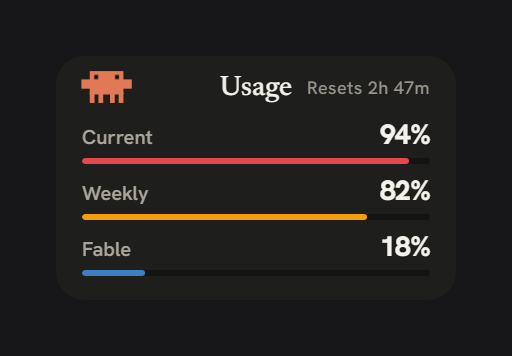
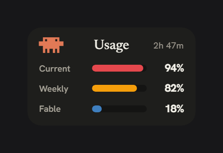
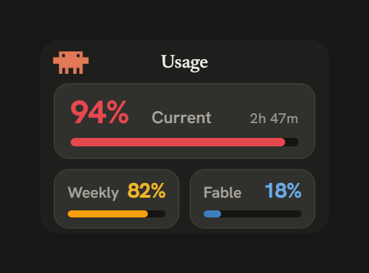
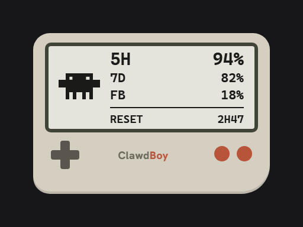
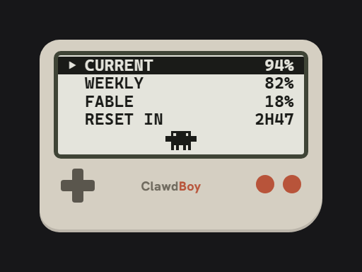
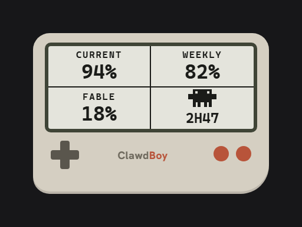
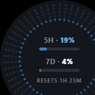
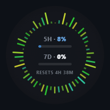
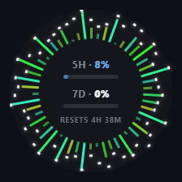

# Clawdometer

A small always-on-top Windows HUD that shows your Claude Code usage limits.

*[Tiếng Việt bên dưới](#clawdometer-tiếng-việt)*

> **Unofficial.** Not affiliated with or endorsed by Anthropic.

## Skins

Nine looks, same numbers. Switch any time: right-click the tray icon → *RICE*.

| Classic | Rowline | Bento Box |
|:---:|:---:|:---:|
|  |  |  |

| ClawdBoy: Table | ClawdBoy: Menu | ClawdBoy: Quad |
|:---:|:---:|:---:|
|  |  |  |

| Audiowave Orb: LED Bloom | Audiowave Orb: Bars | Audiowave Orb: Peak hold |
|:---:|:---:|:---:|
|  |  |  |

The orb skins react to your system audio.

## Install

1. Download `Clawdometer_<version>_x64-setup.exe` from the [latest release](../../releases/latest).
2. Run it. SmartScreen will warn you because the app isn't code-signed. Click *More info* → *Run anyway*, but only for files from this repo's Releases page.
3. Open Clawdometer, then send any message in Claude Code. Your numbers show up.

Already have your own statusline? The HUD leaves it alone. Run `clawdometer install` to chain it.

**Needs:** Windows 10/11, WebView2 (preinstalled on most PCs), and Claude Code (CLI) signed in.

**Build from source** (Rust + [tauri-cli](https://tauri.app)):

```
cargo build --release -p clawdometer-cli
cd app/src-tauri && cargo tauri build
```

## How it works

Claude Code sends usage data to its statusline after every response. Clawdometer reads that. When things go quiet, it runs `claude -p /usage` about once a minute instead.

## Privacy

- **No network requests at all.** HTTP/TLS crates are banned at build time. Check with `cargo deny check bans`.
- **Never touches your credentials.** No telemetry.
- **Only writes to** `~/.clawdometer/` and the `statusLine` key in `~/.claude/settings.json` (backed up first). *Start with Windows* also writes the HKCU Run key, only if you turn it on.

Heads up: the backups in `~/.clawdometer/backups/` are full copies of your settings, secrets included. `clawdometer uninstall --purge` deletes them.

## Uninstall

Run `clawdometer uninstall --purge`, then remove the app from *Apps & features*.

## More

Tray menu, CLI flags, files, full security notes: [docs/details.md](docs/details.md)

License: MIT

---

# Clawdometer (Tiếng Việt)

HUD nhỏ luôn nổi trên cùng cho Windows, hiển thị giới hạn sử dụng Claude Code.

> **Không chính thức.** Không liên kết với và không được Anthropic bảo trợ.

## Giao diện (Skins)

Chín kiểu hiển thị, cùng một dữ liệu. Đổi bất cứ lúc nào: chuột phải vào biểu tượng khay → *RICE*. Xem ảnh ở [phần Skins](#skins) phía trên. Các giao diện Orb phản ứng theo âm thanh hệ thống.

## Cài đặt

1. Tải `Clawdometer_<version>_x64-setup.exe` từ [release mới nhất](../../releases/latest).
2. Chạy nó. SmartScreen sẽ cảnh báo vì ứng dụng chưa được ký số. Bấm *More info* → *Run anyway*, nhưng chỉ với file tải từ trang Releases của repo này.
3. Mở Clawdometer rồi gửi một tin nhắn bất kỳ trong Claude Code. Số liệu sẽ hiện ra.

Đã có statusline riêng? HUD sẽ không động vào. Chạy `clawdometer install` để nối chuỗi.

**Cần:** Windows 10/11, WebView2 (có sẵn trên hầu hết máy), và Claude Code (CLI) đã đăng nhập.

**Tự biên dịch** (Rust + [tauri-cli](https://tauri.app)):

```
cargo build --release -p clawdometer-cli
cd app/src-tauri && cargo tauri build
```

## Cách hoạt động

Claude Code gửi dữ liệu sử dụng cho statusline sau mỗi phản hồi. Clawdometer đọc dữ liệu đó. Khi im ắng, nó chạy `claude -p /usage` khoảng mỗi phút một lần.

## Quyền riêng tư

- **Không gửi request mạng nào.** Các crate HTTP/TLS bị cấm ngay lúc build. Kiểm tra bằng `cargo deny check bans`.
- **Không bao giờ đụng tới thông tin đăng nhập.** Không telemetry.
- **Chỉ ghi vào** `~/.clawdometer/` và khóa `statusLine` trong `~/.claude/settings.json` (sao lưu trước). *Start with Windows* ghi thêm khóa HKCU Run, chỉ khi bạn bật nó.

Lưu ý: bản sao lưu trong `~/.clawdometer/backups/` là bản đầy đủ của settings, kể cả bí mật. `clawdometer uninstall --purge` sẽ xóa chúng.

## Gỡ cài đặt

Chạy `clawdometer uninstall --purge`, rồi gỡ ứng dụng trong *Apps & features*.

## Thêm

Menu khay, lệnh CLI, các file, bảo mật chi tiết: [docs/details.vi.md](docs/details.vi.md)

Giấy phép: MIT
